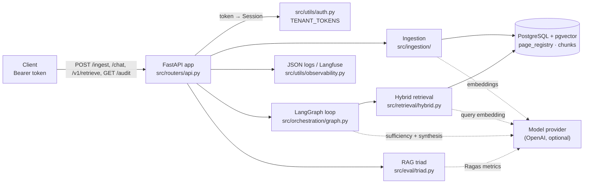
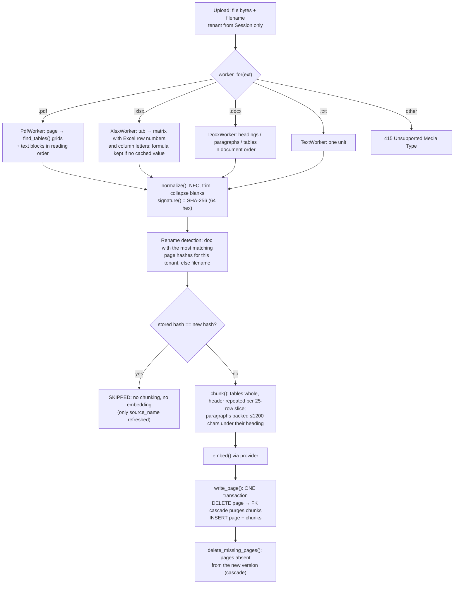
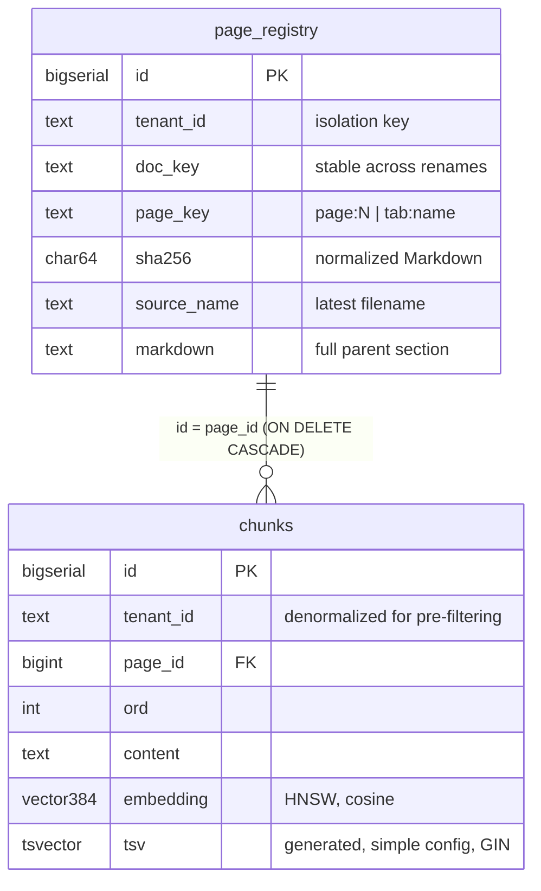
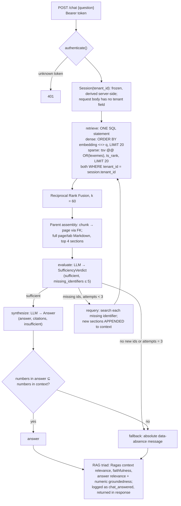

# Architecture (as built)

This document describes the system as merged on `main`. The Step A design exploration, including the
three candidate stacks, is in [`design_dialogue.md`](design_dialogue.md). Open gaps are in
[`known_limitations.md`](known_limitations.md). Paths and constants below are quoted from the code.

## 1. System context

One process (FastAPI, `src/main.py`) and one store (PostgreSQL 16 with pgvector). The model provider
is optional and external.

## 2. Ingestion: from bytes to fingerprinted, chunked pages

**Data abstraction layer.** `Worker.extract(bytes) → list[Unit(page_key, markdown)]` is the only
contract downstream code sees. A unit is a PDF page (`page:N`), an XLSX tab (`tab:<name>`), or a
whole DOCX/TXT file (`page:1`). Everything after the worker handles Markdown only, never formats.

**SHA-256 signature matrix.** Each unit gets one row in `page_registry`, keyed by
`(tenant_id, doc_key, page_key)` and holding `sha256`. The hash covers the *normalized Markdown*, so
whitespace changes and re-saves that don't change content produce the same fingerprint. The gate runs
before chunking, so a hit costs one indexed lookup and no model call.

**Cascading delete control.** `chunks.page_id REFERENCES page_registry(id) ON DELETE CASCADE`. A
changed page is replaced by deleting its registry row and inserting the new one inside a single
`conn.transaction()`. Connections use `autocommit=True`, so that block is a real BEGIN/COMMIT. A
failure at any point rolls back to the previous page and its chunks; the rollback is tested with a
forced mid-transaction error.

## 3. Schema

## 4. Query path: tenant pre-filter, hybrid ranking, self-correction

**Hybrid ranking logic.** The dense leg catches paraphrase; the sparse leg catches exact tokens such
as `INV-0072` or serial numbers. It uses the `simple` text-search config, which doesn't stem or split
identifiers, and ORs the query lexemes so filler words don't cancel a match. Each leg returns ranks,
and RRF scores a chunk as `Σ 1/(60 + rank)`. Fusion works on ranks rather than raw scores, because
cosine distance and `ts_rank` aren't on comparable scales.

**Access control.** The tenant comes from exactly one place: the bearer token, looked up
server-side with a constant-time comparison. `Session` is immutable. The graph never holds a tenant;
it receives a retriever closure already bound to the Session. Both retrieval legs and the
parent-assembly join filter on `tenant_id` *before* ranking, so other tenants' rows are never
scored. Tests cover overlapping content across two tenants at both the SQL and HTTP layers.

**Agentic loop gates.**
1. **Evaluation checkpoint:** a schema-validated sufficiency verdict before any answer is generated.
2. **Re-query routing:** only identifiers not already searched, bounded by `MAX_ATTEMPTS = 3`
   retrieval passes.
3. **Control gate:** returns the fixed insufficient-data message when context is still short, when
   the model marks its own answer as insufficient, or when the answer contains a number absent from
   the retrieved context.

**Prompt-injection defense.** Retrieved text is untrusted.
- It appears only inside a `<documents>` data block in the human message.
- `<` and `>` are escaped, so content can't close that block.
- The system prompt states that nothing inside the block is an instruction.
- Both LLM outputs are Pydantic models (`SufficiencyVerdict`, `Answer`), so free text never drives
  control flow.

## 5. Error boundaries

| Condition | Response | Where |
|---|---|---|
| Missing or unknown token | 401 | `get_session` |
| Unsupported extension | 415 (checked before touching the DB) | `/ingest` |
| Upload over 20 MB | 413 | `/ingest` |
| Unparseable file content | 422 | `/ingest` |
| Empty or oversized question | 422 (Pydantic) | `/chat` |
| No provider configured | 503 | `/ingest`, `/chat` |
| Model provider error (quota, outage, auth) | 503, `provider_error` log | `/ingest`, `/chat` |
| Database unreachable | 503, `db_unavailable` log | all DB paths |
| LLM call over 60 s | 504 | `/chat` |
| A single triad metric fails | answer still returned; metric `null`, `triad_metric_failed` log | `RagasTriadScorer` |
| Whole triad over 90 s or provider error | answer still returned with numeric groundedness only; `triad_unavailable` log | `/chat` |
| Database unreachable at startup, or not at the expected migration revision | startup fails loudly (lifespan) | `create_app`, `require_schema_revision` |
| Empty or oversized question, or `X-Timeout-Ms` outside 1 to 120000 | 422 | `/v1/retrieve` |
| Caller's deadline elapsed, or model call timed out (including a provider-client timeout) | 504 | `/v1/retrieve` |
| Audit row cannot be written | 500, nothing returned; 503 if the database is unreachable | `/ingest`, `/v1/retrieve`, `/chat` |

Timeouts: DB connect 5 s, each LLM call 60 s, the whole triad 90 s, provider client `timeout=60`
with `max_retries=2`.

### Retrieval-only endpoint (`POST /v1/retrieve`)

The chatbot service needs the passages, not an answer (ADR 0001), so this endpoint runs the same
retrieve, evaluate and re-query loop as `/chat` but stops at the first sufficient context instead of
synthesizing (`build_graph(..., retrieve_only=True)`). It returns `{sections, insufficient,
queries_run, attempts}`; when `insufficient` is true `sections` is empty, so a caller cannot answer
from context the evaluator rejected. The tenant comes only from the bearer token. The caller owns
retries: a second chat model is used with `RETRIEVE_LLM_MAX_RETRIES` (default 0, while `/chat` keeps
2), and the caller's deadline arrives in `X-Timeout-Ms` (1 to 120000; 30 s when absent). The contract
is `docs/openapi-v1.json`, checked against the generated document by a unit test.

## 6. Observability

- **Logs:** one JSON object per line (`JsonFormatter`), with any `extra` fields flattened in. Events:
  `page_written`, `file_ingested`, `retrieved`, `node` (per-graph-node timing span),
  `control_gate`, `chat_answered` (tenant, attempts, full triad), `provider_error`,
  `db_unavailable`, `triad_metric_failed`, `triad_unavailable`, `providers_unconfigured`, `schema_verified`.
- **Correlation:** every request gets an ID: the caller's `X-Request-ID` if it is 1–64 characters of `[A-Za-z0-9._-]`, otherwise a new UUID. A context variable stamps it onto every log record as `request_id`, and it is echoed in the `X-Request-ID` response header.
- **Tracing:** a Langfuse LangChain callback is attached to the graph run when `LANGFUSE_*` keys are
  set; otherwise the per-node log spans are the trace.
- **Runtime audit trail vs. build record:** the application logs are the runtime trail.
  `AI_ORCHESTRATION.md` records only the build process.

### Audit trail

Every authenticated `/ingest`, `/v1/retrieve` and `/chat` writes one `audit_log` row: tenant, subject (a fingerprint of the token), action, document key, outcome, `X-Request-ID`, a well-formed `traceparent`, and counts only (never question or document text). An ingest runs in one transaction with its audit row, so the document and its record commit or roll back together; a failed ingest leaves no partial document. For retrieve and chat the row is written before the response is released, and if it cannot be written the request fails (500, or 503 when the database is unreachable) and no data is returned. Failures after authentication (provider errors, timeouts, unparseable files) add an `error` row on a best-effort basis; if even that cannot be written, `audit_error_not_recorded` is logged. The application role can only `SELECT` and `INSERT` on the table. `GET /audit` reads the caller's own tenant, scoped in SQL by the token's tenant.

### Row-level security

The database enforces tenant isolation as well as the SQL predicates. Each request opens its own connection and binds the token's tenant to it (`app.tenant_id`); policies on `page_registry`, `chunks` and `audit_log` compare every row to that setting, with `FORCE ROW LEVEL SECURITY`, so a statement that omitted its `WHERE tenant_id` would still see only the bound tenant, and an unbound connection sees nothing. Writes for another tenant are rejected. The API role is not a superuser and has no `BYPASSRLS`; a superuser connection (for example the owner role in `.env` for host-run development) bypasses the policies. Rationale and the session-level binding: ADR 0002 amendment; benchmark: `docs/reports/rls-benchmark-2026-10-28.md`.

## 7. Key trade-offs

| Decision | Chosen | Alternative | Why |
|---|---|---|---|
| Store | One Postgres with pgvector | Dedicated vector DB plus a relational registry | Purge and upsert stay one ACID transaction; no orphan vectors if a process dies halfway |
| Fusion | RRF over ranks | Weighted score sum | No score calibration between cosine and `ts_rank` |
| Hash unit | Normalized Markdown per page/tab | Raw file bytes | A renamed or re-saved file with unchanged content skips re-embedding; one changed row re-embeds one page |
| Document identity | Page-hash overlap, else filename | Caller-supplied ID only | Renames are detected automatically; `doc_key` can still be passed explicitly |
| Groundedness | Ragas (LLM) plus a deterministic numeric check | Ragas only | The numeric check is free, can't hallucinate, and blocks made-up figures before the answer is returned |
| Tenancy | Token → tenant on the server | Tenant in the request | A caller can't name someone else's tenant |

## 8. Constraints, failure modes, scaling

- **Scale ceiling.** pgvector HNSW recall and latency trail dedicated vector stores past roughly
  1M vectors. The next step would be partitioning `chunks` by `tenant_id` before switching stores.
- **Embedding dimension** is fixed at 384 in the schema. Changing models means a migration and
  re-embedding.
- **Per-request connection, no pool.** That's fine for a prototype. Under concurrency, add
  `psycopg_pool` and bound it.
- **Cost per question.** Up to 3 sufficiency calls, 1 synthesis and about 3 Ragas metric calls. The
  triad runs inline, which adds latency; moving it to a background task would decouple it.
- **Rename detection** needs at least one unchanged page. A fully rewritten, renamed file becomes a
  new document, and the old one stays until deleted.
- **Windows event loop.** psycopg async needs a SelectorEventLoop, which `src/main.py` sets
  explicitly.
- **Unverified live paths.** The OpenAI, Ragas-scoring and Langfuse paths have not run against live
  services; see `known_limitations.md`.
